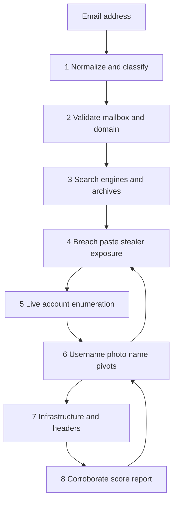

# Email OSINT Guide 101

**The complete email OSINT guide for investigators, journalists, SOC analysts, and researchers.** Learn how to investigate an email address, run a reverse email lookup, map linked accounts, analyze email headers, and turn one inbox identifier into a defensible digital footprint — using only publicly available sources.

This is a field manual, not a tool dump. Most “email OSINT” pages list 40 links and stop. This guide teaches the **workflow, classification, corroboration, and evidence rules** that separate a screenshot collection from an investigation you can stand behind.

> **Scope.** Passive, lawful, public-source intelligence only. Do not log into accounts you do not own. Do not complete password resets. Do not use breach credentials. Do not harass, stalk, or impersonate anyone.

**Maintained by [OSINTverse](https://osintverse.com)** · License: [CC BY 4.0](LICENSE)

---

## What this email OSINT guide covers

- How **email OSINT** works, and why an address is usually the strongest identity pivot you will get
- How to **classify** an address before you waste hours chasing a throwaway, a role inbox, or a spoofed From line
- An **8-phase investigation workflow** you can run in 15 minutes or expand into a full case file
- How to find **social media, usernames, Gravatar photos, GitHub commits, PGP keys, WHOIS, and breach history** from one address
- How to do **Gmail OSINT**, Microsoft / Outlook OSINT, Proton Mail OSINT, and corporate-domain email hunting
- How to **analyze email headers** for spoofing, phishing, and infrastructure clues
- A **confidence scoring** model so you stop attributing “jsmith” on Reddit to the wrong person
- Checklists, dorks, tool tables, and a worked example

**Deep dives**

| Guide | Use it when |
| --- | --- |
| [Investigation checklist](docs/checklist.md) | You want a printable case worksheet |
| [Email OSINT tools](docs/tools.md) | You need the full tool directory |
| [Google dorks for email OSINT](docs/dorks.md) | You are hunting public mentions and files |
| [Email header analysis](docs/headers.md) | You have a received message to forensically read |
| [Provider playbooks](docs/providers.md) | The domain is Gmail, Outlook, Proton, iCloud, or custom |
| [FAQ](docs/faq.md) | You need a short answer to a specific question |

---

## Table of contents

1. [What is email OSINT?](#what-is-email-osint)
2. [Legal, ethical, and operational rules](#legal-ethical-and-operational-rules)
3. [Why an email address is the best OSINT pivot](#why-an-email-address-is-the-best-osint-pivot)
4. [Anatomy of an email address](#anatomy-of-an-email-address)
5. [Classify the address first](#classify-the-address-first)
6. [Investigator OPSEC](#investigator-opsec)
7. [The 8-phase email OSINT workflow](#the-8-phase-email-osint-workflow)
8. [Phase 1 — Normalize and classify](#phase-1--normalize-and-classify)
9. [Phase 2 — Prove the mailbox is real](#phase-2--prove-the-mailbox-is-real)
10. [Phase 3 — Search-engine and archive sweep](#phase-3--search-engine-and-archive-sweep)
11. [Phase 4 — Breach, paste, and stealer exposure](#phase-4--breach-paste-and-stealer-exposure)
12. [Phase 5 — Account enumeration](#phase-5--account-enumeration)
13. [Phase 6 — Identity pivots](#phase-6--identity-pivots)
14. [Phase 7 — Domain infrastructure and headers](#phase-7--domain-infrastructure-and-headers)
15. [Phase 8 — Corroborate, score, and report](#phase-8--corroborate-score-and-report)
16. [Confidence scoring](#confidence-scoring)
17. [What goes wrong](#what-goes-wrong-in-email-osint)
18. [Worked example](#worked-example-a-15-minute-triage)
19. [Starter tool stack](#starter-tool-stack)
20. [Reduce your own email OSINT surface](#reduce-your-own-email-osint-surface)
21. [Keep this guide current](#keep-this-guide-current)

---

## What is email OSINT?

**Email OSINT** (email open-source intelligence) is the structured use of publicly available information to learn what an email address is, who likely controls it, which platforms it is tied to, how old it is, and whether a received message from it is authentic.

It is **not**:

- Breaking into an inbox
- Resetting someone else’s password
- Using leaked passwords
- Sending mail to the target to “see if it bounces”
- Buying or browsing stolen credential dumps for the passwords themselves

A competent email investigation answers five questions:

| Question | What “good” looks like |
| --- | --- |
| Is the address real? | Syntax is valid, the domain can receive mail, and at least one independent source has seen it |
| What kind of address is it? | Personal, work, role, alias, disposable, catch-all, or spoofed |
| Where does it live online? | Registrations, public posts, documents, commits, WHOIS, Gravatar, PGP |
| How old and how exposed is it? | Earliest public appearance, breach timeline, infostealer hits |
| Can I name the person? | Only after two or more independent corroborating signals |

Volume of hits is not the metric. **Reproducibility** is. If another analyst cannot rerun your queries and reach the same conclusion, you do not have intelligence. You have a vibe.

---

## Legal, ethical, and operational rules

Email addresses are personal data in most jurisdictions, including under the GDPR and similar privacy laws. Public availability does not automatically make every use lawful.

**Have a lawful basis before you start.** Typical legitimate uses: phishing and fraud investigation, journalism in the public interest, authorized threat intelligence, incident response on mail you received, due diligence you are legally allowed to perform, and researching your own exposure.

**Hard stops**

- Do not access an account you do not own or administer. That violates the US Computer Fraud and Abuse Act, the UK Computer Misuse Act, and equivalent laws almost everywhere.
- Do not use passwords, session cookies, or recovery codes from breaches or infostealer logs. Breach *names and data classes* are intelligence. Credentials are a crime scene, not a login form.
- Do not complete a password-reset flow. Registration-check tools that read a public “this email is already used” response are one thing. Triggering a reset email to the subject is another.
- Do not use this guide for stalking, harassment, doxxing, or employment / tenant / credit screening. OSINT tools are **not** FCRA consumer reports.
- Automated checks can violate a site’s terms of service even when they are not a crime. Keep volume low. Prefer official lookup pages and your own search queries.

**Document purpose.** Write one sentence at the top of the case file: *why* you are looking at this address, *who* authorized it, and *what* you will not do.

This guide is educational. You are responsible for the law where you operate.

---

## Why an email address is the best OSINT pivot

Names collide. Phone numbers change. Usernames get recycled. An email address is the identifier almost every online service still requires, then stores forever.

That creates four properties investigators exploit:

1. **Persistence.** People keep the same Gmail or work address for a decade. A 2013 breach record still proves the address existed then.
2. **Centrality.** One address sits in the middle of social accounts, GitHub commits, domain registrations, newsletters, Gravatar, and password-reset graphs.
3. **Guessability.** Corporate mail follows `first.last@company.com` patterns. You can often *construct* a candidate address from a name and an employer, then verify it from public sources.
4. **Searchability.** Unlike a phone number, an email is a unique string that search engines, paste sites, code hosts, and archives index as-is.

Start with the email when you have it. When you do not, build candidates from name + domain, then run the same workflow.

---

## Anatomy of an email address

```
local-part @ domain
     |         |
  j.smith+hr   acme.com
```

| Piece | Why it matters |
| --- | --- |
| **Local-part** | Often a real name, a reused handle, a role (`info`, `billing`), or a plus-tag (`user+shop`) |
| **Plus tag** | `name+paypal@gmail.com` is usually an alias of `name@gmail.com`, not a second person |
| **Dots (Gmail only)** | On consumer Gmail, `j.smith` and `jsmith` are the **same mailbox**. Dots *do* matter on Google Workspace and almost every other provider |
| **googlemail.com** | Treat as `gmail.com` for consumer accounts |
| **Domain** | Tells you provider, employer, disposable farm, or custom infrastructure |
| **TLD** | `.edu`, `.gov`, `.mil`, country codes, and brand-new cheap TLDs change your hypothesis immediately |

**Normalize before you search.** Lowercase the address, trim whitespace, map `googlemail.com` → `gmail.com`, strip a plus-tag into a *separate* note (keep both forms), and for consumer Gmail only, also store the dotless local-part.

Example:

```
Input:   J.Smith+News@Googlemail.com
Keep:    j.smith+news@gmail.com     (original, as used)
Also:    j.smith@gmail.com          (plus-stripped)
Also:    jsmith@gmail.com           (Gmail-normalized)
```

Search all three. People publish different forms in different places.

---

## Classify the address first

Do this before Holehe, before GHunt, before you write a name in the file. Classification decides how much the rest of the case is worth.

| Class | Signals | How to treat findings |
| --- | --- | --- |
| **Consumer webmail** | `gmail.com`, `outlook.com`, `icloud.com`, `yahoo.com`, `proton.me` | Strong personal pivot if you can corroborate |
| **Corporate / school** | Custom domain, MX at Microsoft 365 / Google Workspace / Proofpoint | Ties to an org. Person-level attribution needs a name pattern or a public staff page |
| **Role / shared** | `info@`, `support@`, `admin@`, `hr@`, `noc@` | **Do not** attribute to one human |
| **Plus-alias** | `+tag` in the local-part | Same mailbox as the base address on Gmail / Outlook / iCloud |
| **Disposable / temp** | Mailinator-class domains, very new domain, shared throwaway MX | Low attribution value. Useful as a *tradecraft* signal (fraud, throwaway signup) |
| **Catch-all** | Domain accepts any local-part | “Valid” verification is meaningless. Prefer documents and breaches over SMTP-style checks |
| **Forwarder / alias domain** | SimpleLogin, AnonAddy, Firefox Relay, custom catch-all forwarders | Masks the real mailbox. Pivot on where the alias was *used*, not on the alias domain |
| **Spoofed display** | From header does not match Return-Path / DKIM `d=` | You may not be investigating the claimed address at all |

**MX fingerprints** (public DNS) often identify the real mail host behind a custom domain:

| MX / SPF clue | Likely provider |
| --- | --- |
| `aspmx.l.google.com`, `gmail-smtp-in.l.google.com` | Google Workspace or Gmail |
| `*.mail.protection.outlook.com` | Microsoft 365 |
| `mail.protonmail.ch`, `mailsec.protonmail.ch` | Proton Mail (custom domain = paid plan) |
| `mx01.mail.icloud.com` | iCloud+ custom domain |
| `inbound.fastmail.com` | Fastmail |
| `mx.zoho.com` | Zoho Mail |
| Brand-new domain + obscure shared MX + no website | Disposable farm or purpose-built persona |

A custom domain on Proton MX is a useful signal: the operator is paying for Proton and chose to hide or professionalize the mailbox. That is not proof of sophistication. It is a lead.

---

## Investigator OPSEC

Never run an investigation from your personal browser profile, personal Google account, or home IP if the work is sensitive.

**Minimum viable lab**

- Separate browser profile (or VM) with no personal logins
- VPN or institutional egress you are allowed to use
- Evidence folder with date-stamped captures
- Sock-puppet accounts only where a platform requires a login *and* your policy allows it — never your real identity, never reused across cases
- Assume every web lookup (Epieos, HIBP, Hunter) is logged by that service. For client work with strict data-handling rules, prefer local tools and search engines you control

**Do not contaminate the case.** The most common OPSEC failure is searching a target email while logged into LinkedIn, Google, or Facebook as yourself.

---

## The 8-phase email OSINT workflow



The process is a loop, not a ladder. A GitHub username found in phase 6 sends you back to breach search. A second email in a Gravatar profile restarts the whole cycle.

**15-minute triage:** phases 1–5 and a header skim if you have a message.  
**Full case:** all eight phases, screenshots, hashes, and a written confidence assessment.

---

## Phase 1 — Normalize and classify

1. Copy the address exactly as it appeared (typos included).
2. Produce the normalized forms described above.
3. Split `local-part` and `domain`.
4. Label the class (consumer, corporate, role, disposable, catch-all, alias, spoofed).
5. Extract candidate usernames from the local-part: `j.smith+hr` → `j.smith`, `jsmith`, `j_smith`, `smith`.
6. If the local-part looks like `firstname.lastname` or `flast`, write the name hypothesis *as a hypothesis*, not a fact.

Stop if the address is disposable *and* the case does not specifically require tracing throwaway tradecraft. Do not spend an afternoon on `x8k2@tempmail-example.com` unless fraud methodology is the point.

---

## Phase 2 — Prove the mailbox is real

You need a *reason to believe* the address can receive mail or has been used. You do not need to knock on the mailbox.

**Passive checks that are enough for most cases**

1. **Syntax.** RFC-looking local-part, valid domain, no illegal characters.
2. **DNS.** The domain has MX records, or at least A/AAAA (implicit MX). No MX and no A usually means the address cannot receive internet mail.
3. **Public appearance.** The address is on a website, PDF, GitHub commit, WHOIS record, or news page. That is stronger evidence than any “verifier” API.
4. **Commercial verification (optional).** Hunter.io, Email Hippo, and similar services return valid / risky / invalid / catch-all. Treat **catch-all as unknown**, not valid.
5. **Provider UI hints (careful).** Some webmail compose windows show an avatar or “not found” state as you type an address. Use this only on a platform you already have an account on, and do not send the message.

**Do not** open a raw SMTP session and probe `RCPT TO` against a stranger’s mail server. That is noisy, often blocked, and easy to interpret as unauthorized access. If you need deliverability, use a reputable verifier or rely on public sightings.

**Gmail-specific note.** Consumer Gmail will not let a second person register a dotted variant of an existing address. That is a weak existence hint, not a person-identification method.

---

## Phase 3 — Search-engine and archive sweep

This is still the highest-ROI step in email OSINT, and the one tool pages skip.

Run the **quoted** address on Google, Bing, DuckDuckGo, and Yandex. Then run the normalized variants. Then run the domain-only queries if it is a corporate domain.

Start here, then use the full cookbook in [Google dorks for email OSINT](docs/dorks.md):

```text
"j.smith@acme.com"
"j.smith@acme.com" filetype:pdf
"j.smith@acme.com" filetype:xlsx OR filetype:csv
"j.smith@acme.com" site:github.com
"j.smith@acme.com" site:gitlab.com
"j.smith@acme.com" site:linkedin.com
"j.smith@acme.com" site:pastebin.com OR site:justpaste.it
"j.smith@acme.com" site:reddit.com
"j.smith@acme.com" "password" OR "username" OR "login"
intext:"@acme.com" -site:acme.com
```

**Also search**

- Google (and Bing) **cached** copies
- [Wayback Machine](https://web.archive.org) for pages that once listed the address
- [archive.today](https://archive.ph)
- Code search: GitHub, GitLab, grep.app, searchcode — config files, author fields, `mailto:` links
- Document search: slides, CVs, conference programs, procurement PDFs, court filings
- News and academic indexes for authors and press contacts

**Set a Google Alert** on the quoted address if the case will last more than a day.

Capture the URL, title, date seen, and a screenshot or archive link for every hit. A search result that vanishes tomorrow is not evidence unless you saved it.

---

## Phase 4 — Breach, paste, and stealer exposure

Breach data is a **timeline and a platform map**. It is not a password list for you to try.

### Have I Been Pwned

[Have I Been Pwned](https://haveibeenpwned.com) is the default first stop. For each hit, record:

- Breach name and domain
- Breach date (when the data was taken, not when HIBP added it)
- Data classes (email only vs email + phone + password + address)
- Whether it is a “paste” rather than a confirmed breach

**How to read it**

- Earliest breach date ≈ **minimum age** of the address
- A 2016 LinkedIn breach means a LinkedIn account existed in 2016. It does **not** mean the account exists today
- Phone or physical-address data classes are pivot gold — pursue those identifiers only through lawful public sources
- Multiple password-class breaches raise *credential-reuse risk* for the subject’s own security. That is a finding for a defender’s brief, not a reason to attempt login

### Other public-facing sources

| Source | What it is good for |
| --- | --- |
| [Intelligence X](https://intelx.io) / [Phonebook.cz](https://phonebook.cz) | Wider paste and document index; Phonebook is excellent for `@domain` harvests |
| [Hudson Rock](https://www.hudsonrock.com/free-tools) free tools | Whether an email or domain appears in **infostealer** telemetry (malware-stolen sessions). A hit means a device was compromised, which is a different story than a website breach |
| DeHashed, LeakCheck, Snusbase | Paid, deeper breach corpora. Use only if your organization is licensed and your purpose is authorized. Still: never use the passwords |

**Paste sites.** Search the quoted address on Pastebin, Ghostbin, and via dorks. Pastes often include surrounding usernames and context that HIBP will not show.

**Rules of interpretation**

- A breach record is historical. Confirm the account *now* before you write “has a Spotify account.”
- Addresses get recycled on some providers. A 2012 Myspace hit may not be the current controller.
- Infostealer hits describe a **compromised endpoint**, not proof the person is a criminal.

---

## Phase 5 — Account enumeration

Now you want the **live** footprint: where is this address registered today?

Two tools answer different questions. Use both.

| Tool | Question it answers | Best use |
| --- | --- | --- |
| **[Epieos](https://epieos.com)** | *Who* might be behind this? | Fast Google / Microsoft name + avatar pivot, plus selected linked services |
| **[Holehe](https://github.com/megadose/holehe)** | *Where* is it registered? | Live registration checks across 100+ sites |
| **[user-scanner](https://github.com/kaifcodec/user-scanner)** | Email *and* username, in bulk | Modern combined scanner; good for lists |
| **[GHunt](https://github.com/mxrch/GHunt)** | What is public on this **Google** account? | Maps reviews, public calendar, profile photos, YouTube — if the address is a Google account |
| Hosted platforms (OSINT Industries and similar) | Correlation + breach + accounts in one report | Time-limited professional cases |

### Epieos — identity first

Paste the address. If Epieos recovers a **display name** or **profile photo** from a Google or Microsoft account, that is often the highest-value five seconds of the case. Write them down. Reverse-search the photo immediately.

Epieos is a hosted service. You are sending the target address through a third party. For sensitive cases, skip it and use local tools.

### Holehe / user-scanner — footprint next

These tools detect whether a site already knows the address, typically by reading public signup or reset-page behavior. They do not guess passwords and they should not complete a reset.

```bash
pipx install holehe
holehe j.smith@acme.com
```

**How to use the output**

- Treat each “found” as a **lead**, then open the site yourself and confirm
- A “not found” is **not** proof of absence. Modules break when sites change their pages
- Compare the live list with HIBP. Platforms in *both* lists are higher confidence
- If a site echoes a masked recovery phone or recovery email, that is a new identifier — handle it as sensitive personal data

**Do not** fire these tools at hundreds of addresses from your home IP. You will get rate-limited and you may violate terms of service. One subject, low volume, documented purpose.

### Gravatar — the underrated face pivot

Gravatar still ties a public avatar (and sometimes a full profile) to an email hash.

1. Trim and lowercase the address.
2. SHA-256 hash it (Gravatar’s current identifier; older writeups still say MD5 — prefer SHA-256).
3. Request the avatar with `?d=404` so a miss fails closed.
4. If an image returns, reverse-search it.
5. Request the public profile JSON for the same hash.

```bash
# Linux / macOS / WSL
email="j.smith@acme.com"
hash=$(printf '%s' "$email" | tr '[:upper:]' '[:lower:]' | sha256sum | awk '{print $1}')
echo "https://www.gravatar.com/avatar/${hash}?d=404"
echo "https://gravatar.com/${hash}.json"
```

A custom photo plus a display name plus verified account links is often enough to start phase 6. A 404 means “no public Gravatar,” not “no person.”

### Gmail / Google deep dive

If the address is a Google account (Gmail, or a custom domain on Google Workspace, or a non-Gmail address used as a Google login):

- **GHunt** can pull *public* Google profile data after you authenticate *your own* investigator Google account. Typical public yields: profile / cover photo, Google Maps reviews (locations, timestamps), public calendar, YouTube, Play Games.
- Maps reviews are the famous win: a trail of restaurants and shops is a pattern-of-life source. Treat each review as a *visit claim*, not GPS truth, and watch for copied or thin review farms.
- Google often shows an avatar in Gmail’s compose window when the address is a Google account. Do not send mail.

Details: [Provider playbooks](docs/providers.md).

---

## Phase 6 — Identity pivots

Every new identifier you just found is a new case.

### Username derivation

From `j.smith1984@gmail.com` generate, then search:

```text
j.smith1984
jsmith1984
j_smith1984
johnsmith1984
jsmith
smith1984
```

Run candidates through [WhatsMyName](https://whatsmyname.app), [Maigret](https://github.com/soxoj/maigret), or [Sherlock](https://github.com/sherlock-project/sherlock). Prefer WhatsMyName or Maigret for a first pass; Sherlock is still useful but noisier.

**Attribution rule:** a matching username is **not** the same person. Common handles are shared by thousands of strangers. Require a second signal (same photo, same name, same city, a cross-link, a unique bio string) before you merge profiles.

### Name and photo

- Reverse-image the Gravatar / Google / Microsoft / platform avatars on Google Lens, Yandex, and TinEye
- Search `"First Last" "Acme"` and `"First Last" email` on Google and LinkedIn via `site:linkedin.com/in`
- Look for the same crop of the same selfie. People reuse photos more than they reuse brains

### GitHub and developer traces

Developers leak mail constantly.

- GitHub search: `author@example.com`, `committer-email`, and code hits
- [osgint](https://github.com/hippiiee/osgint) — username ↔ email using public commits and published GPG keys
- GitHub noreply form: `ID+username@users.noreply.github.com` still identifies the account
- Public GPG keys on `https://github.com/<user>.gpg` often embed an email

### PGP keyservers

Search the address on [keys.openpgp.org](https://keys.openpgp.org) and other public keyservers. A published key can include a **name, photo, creation date, and additional UIDs** (other emails). That is a clean, intentional public identity — high-quality OSINT.

### Reverse WHOIS

If the address registered domains, [ViewDNS Reverse WHOIS](https://viewdns.info/reversewhois/), Whoxy, and Whoisology will list them. Domain portfolios reveal businesses, side projects, and sometimes a home address in older records.

### Certificate Transparency

Older certificates sometimes embed an email in the subject or SAN. Search [crt.sh](https://crt.sh) for the domain and, where present, the address.

### Second emails

Gravatar, PGP UIDs, GitHub, WHOIS, and bios regularly produce a second address. **Restart the workflow** on it. The second address is often the older, leakier personal mailbox.

---

## Phase 7 — Domain infrastructure and headers

### Custom-domain infrastructure

Skip this for `gmail.com`. For everything else, build a one-page infrastructure card:

| Check | Tool | What you want |
| --- | --- | --- |
| MX, A, NS, TXT | `dig` or MXToolbox | Who hosts mail and the website |
| SPF / DKIM / DMARC | `dig TXT` / `_dmarc.` | How seriously the domain is run; spoofability |
| WHOIS | whois / Domaintools | Created date, registrar, privacy, historic registrant |
| Age vs content | WHOIS + the website | Brand-new domain + copied site = persona or phish kit |
| Sister domains | reverse WHOIS, SecurityTrails | Same registrant or same nameservers |
| Blacklists | MXToolbox | Spam / botnet reputation of the sending domain |

**Reading the domain like an investigator**

- Registered last week, privacy WHOIS, Cloudflare, no real site → treat as **purpose-built**
- Ten-year-old domain, Google Workspace, staff pages, matching LinkedIn → treat as **organizational**
- Proton or Fastmail MX on a personal domain → treat as **privacy-conscious individual**, not automatically “threat actor”

Harvest other addresses on the same domain with Hunter.io, Phonebook.cz, and [theHarvester](https://github.com/laramies/theHarvester). Discover the **pattern** (`first.last`, `flast`, `first`) before you guess more names.

### Email header analysis

If you **received** a message, headers beat every lookup tool.

Read them yourself. Then paste a copy into [MXToolbox Header Analyzer](https://mxtoolbox.com/EmailHeaders.aspx) or a local parser. Full walkthrough: [Email header analysis](docs/headers.md).

**Minimum read**

1. Save the raw `.eml` and hash it (SHA-256). That is your evidence file.
2. Compare `From`, `Return-Path`, `Reply-To`, and DKIM `d=`. Mismatches are the first spoofing tell.
3. Read `Received:` **bottom to top**. The first hop your own trusted gateway recorded is the one you can believe.
4. Read `Authentication-Results` for SPF / DKIM / DMARC. A DMARC fail with `p=reject` on a bank or CEO domain is a strong spoofing signal. Forwarding can also break SPF — do not stop at one red word.
5. `X-Originating-IP` is a lead, not truth. Consumer Gmail and Microsoft 365 usually **strip** the sender’s personal IP.
6. `Message-ID` domain and `X-Mailer` / `User-Agent` profile the sending stack.

**How to open headers**

- Gmail: ⋮ → **Show original**
- Outlook: file properties → Internet headers
- Apple Mail: View → Message → All Headers

Never click links or open attachments from a suspicious sample on your investigation workstation. Defang URLs (`hxxps://`, `example[.]com`) before you paste them anywhere.

---

## Phase 8 — Corroborate, score, and report

You now have a pile of identifiers. Most of them are wrong, stale, or about someone else with the same handle.

**Merge two profiles only when** at least two of these agree:

- Same uncommon name **and** same employer or city
- Same photograph (not a celebrity stock image)
- Explicit cross-link (“this is my GitHub”, same URL in two bios)
- Same unique string (middle name + graduation year + hobby blog)
- Same phone or second email recovered from two independent public sources

**Write the report as claims with sources**, not as a biography:

```text
Claim: The address j.smith@acme.com is registered on GitHub as @jsmith-dev
Source: Holehe 2026-10-01; confirmed at https://github.com/jsmith-dev (archived)
Confidence: High
Caveat: Display name is "J", not a full legal name
```

Include contradictions. “LinkedIn says London, Maps reviews cluster in Manchester” is more useful than picking the answer you like.

Use the [investigation checklist](docs/checklist.md) as the case file template.

---

## Confidence scoring

Score **each claim**, not the whole person.

| Score | Meaning | Example |
| --- | --- | --- |
| **High** | Two independent public sources, or a primary source you archived | Address in a signed PGP UID *and* on the company staff page |
| **Medium** | One strong source, or two weak ones | Holehe + current profile page, no photo match yet |
| **Low** | Single weak or stale source | HIBP 2012 hit; username-only Sherlock result |
| **Rejected** | Contradicted or common-handle collision | `alex` on Instagram with a different face |

Never promote a Low claim to High because you “have a feeling.” Feelings do not survive discovery, editors, or court.

---

## What goes wrong in email OSINT

**Role inboxes.** `info@` is a department. Your “person” is six interns and a ticket queue.

**Username collisions.** `mike87` is not a unique identifier. `mike87-trombone-leeds` might be.

**Holehe false negatives.** Sites change. Rate limits lie. Confirm by hand when the platform matters.

**Breach as present tense.** “Was on LinkedIn in 2016” ≠ “is on LinkedIn.”

**Catch-all domains.** Verifiers say valid. The mailbox may bounce into `/dev/null`.

**Spoofed From.** You investigated the CFO’s address. The mail came from a bulletproof host with a forged header. Always read `Authentication-Results` when you have a message.

**Gmail IP mythology.** You will not geolocate a consumer Gmail sender from headers in 2026. Google stripped that years ago.

**Plus-tags and dots.** You opened five case files on one human.

**Shared computers and family plans.** An infostealer hit or a Netflix registration may be a spouse, a child, or an internet café.

**Chain of custody.** Accounts get deleted. Archive now: screenshot with UTC timestamp, WARC or SingleFile, Wayback / archive.today URL, raw header file + hash.

---

## Worked example: a 15-minute triage

*Fictional address for teaching. Do not treat this as a real person.*

**Input:** a tip from `sam.lee+press@proton.me` claiming to be a city official.

| Minute | Action | Result |
| --- | --- | --- |
| 0–2 | Classify | Consumer Proton, plus-tag `press`. Base: `sam.lee@proton.me`. Name hypothesis: Sam Lee |
| 2–4 | Quoted Google / Bing | No city website hit. One 2021 conference PDF lists `sam.lee@olduniv.edu` |
| 4–6 | HIBP on both addresses | Proton address: no breaches. University address: 2016 LinkedIn, 2018 Canvas |
| 6–8 | Epieos + Gravatar | No Google avatar. Gravatar 404 |
| 8–10 | Holehe on Proton address | Positive on GitHub, Reddit. Negative on LinkedIn |
| 10–12 | Username `samlee` / `sam-lee` | GitHub `@samlee` bio: “formerly @olduniv”. Photo matches a public faculty page *for a different Sam Lee* — **hold** |
| 12–14 | Headers on the tip mail | DKIM `d=proton.me` pass. No personal IP (expected). Message-ID consistent with Proton |
| 14–15 | Report | Address is a real Proton mailbox with a developer footprint. **Not yet** the city official. Next step: call the city’s published press office, do not engage the tipster as verified |

That is a successful investigation. You stopped a bad attribution.

---

## Starter tool stack

You do not need twenty subscriptions. This is enough to run the whole workflow.

| Job | Free starting point | When to pay |
| --- | --- | --- |
| Existence / pattern | Search engines, Hunter.io free tier | Hunter, RocketReach for bulk corporate |
| Breaches | Have I Been Pwned | IntelX, licensed breach platforms |
| Stealers | Hudson Rock free lookup | Full cybercrime intel platforms |
| Who is this? | Epieos, Gravatar, Google | — |
| Where is it registered? | Holehe, user-scanner | Hosted multi-platform APIs |
| Google-deep | GHunt (your own account) | — |
| Usernames | WhatsMyName, Maigret | — |
| Domain harvest | Phonebook.cz, theHarvester | SecurityTrails, Hunter |
| Headers / DNS | MXToolbox, `dig` | — |
| Evidence | SingleFile, Wayback, archive.today | Hunchly |
| Graphing | Paper, Obsidian, or Maltego CE | Maltego paid transforms |

Full annotated directory: [Email OSINT tools](docs/tools.md).

---

## Reduce your own email OSINT surface

If you can do this to others, others can do it to you.

- Use **unique aliases** (SimpleLogin, Proton hide-my-email, iCloud Hide My Email) per service
- Do not put your real mailbox on GitHub commits — enable GitHub’s private email
- Delete or lock unused accounts that HIBP still lists
- Remove public Gravatar data you do not need
- Keep Maps reviews and public calendars on purpose, or turn them off
- Do not reuse the email local-part as your global username
- Register domains with privacy WHOIS and a role address, not your personal Gmail
- Assume every password-reset page on the internet will admit that you have an account there

---

## Keep this guide current

Tools rot. Password-reset oracles close. Gravatar changed MD5 to SHA-256. Gmail stripped sender IPs. Any email OSINT guide that still tells you to “just read X-Originating-IP on Gmail” is already wrong.

When you find a dead module or a better public source, open an issue or a pull request. See [CONTRIBUTING.md](CONTRIBUTING.md).

**Related OSINTverse**

- [OSINTverse](https://osintverse.com) — tools, learning, and community
- Questions: [hi@osintverse.com](mailto:hi@osintverse.com)

---

## License

This guide is © 2026 OSINTverse and released under [CC BY 4.0](LICENSE). Credit **OSINTverse Email OSINT Guide 101** and link back to this repository.

Not legal advice. Not an FCRA consumer report. Not an invitation to access anyone’s account.
